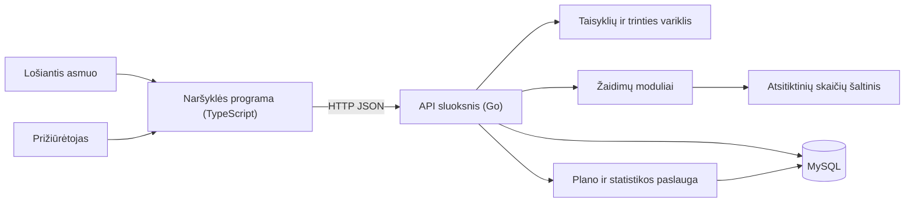

# Nuolydis: eksperimentinė azartinių lošimų mažinimo priemonė

Kursinio darbo I dalis: projektavimo dokumentas

> **Eksperimentinio pobūdžio pastaba.** Nuolydis yra eksperimentinė pagalbinė priemonė, o ne gydymas ir ne saugaus lošimo garantija. Mokslinė literatūra kol kas neatsako, ar lošimo imitavimas mažina, ar didina realų lošimą (žr. šaltinius). Prototipas bus tikrinamas tik su sintetiniais duomenimis, realūs priklausomybę turintys žmonės į bandymus nebus įtraukiami.

# 1. Problema ir idėja

**Sistema vienu sakiniu:** Svetainė žmogui, kuris yra giliai įsitraukęs į azartinius lošimus ir negali sustoti, bei jo pasirinktam prižiūrėtojui, leidžianti lošti tik virtualiais taškais pagal sutartą, palaipsniui mažėjantį planą.

**Problema ir dabartinis procesas:** Dabar naudojamas Lietuvos asmenų, apribojusių galimybę lošti, registras, blokavimo programos arba artimųjų atliekama pinigų kontrolė. Šie būdai dažniausiai reikalauja nutraukti lošimą iš karto. Žmogui, kuris negali sustoti, tai aukštas slenkstis, nes nėra tarpinio etapo. Artimasis taip pat neturi bendro ir objektyvaus vaizdo, kaip keičiasi elgesys.

**Nauda:** Lošiantis asmuo gali pradėti beveik be kliūčių ir neprarasdamas pinigų, o žaidimas palaipsniui tampa retesnis ir reikalauja daugiau sąmoningų veiksmų. Abu naudotojai mato tą patį pažangos rodiklį.

**Naudotojai:**

- **Lošiantis asmuo** žaidžia virtualiais taškais, patvirtina įspėjimus, praneša apie lošimą tikrais pinigais ir stebi savo pažangą.
- **Prižiūrėtojas** nustato ribas ir sąlygas, tvirtina išimtis, gauna įspėjimus ir mato tendencijas.

**Prielaidos:**

- *Žinoma:* registras veikia visose Lietuvoje registruotose lošimų bendrovėse. Simuliuoto ir piniginio lošimo ryšys moksliškai neišspręstas, o kai kuriems žmonėms simuliacija gali padidinti norą lošti.
- *Prielaida:* naudotojai dalyvauja savanoriškai ir sutinka su prižiūrėtojo vaidmeniu.
- *Prielaida:* virtualūs taškai gali pakeisti dalį potraukio lošti. Tai nepatvirtinta, todėl sistema renka duomenis apie atkryčius.
- *Prielaida:* žaidimas be piniginės vertės prizų nėra azartinis lošimas pagal Lietuvos teisę. Teisiškai tai dar reikėtų patikrinti.
- *Prielaida:* pranešimai apie lošimą tikrais pinigais yra sąžiningi, nes sistema jų patikrinti negali.

# 2. Apimtis

| Funkcija | Ką naudotojas galės atlikti | Pagrindinis modulis ar pagalbinė funkcija |
| --- | --- | --- |
| Žaidimo taisyklių ir trinties variklis | Kiekvienas sesijos pradėjimas ir statymas gauna sprendimą su priežasties kodu | **Pagrindinis modulis** |
| Žaidimai | Žaisti ruletę, lošimo automatus, „Plinko“ ir „Blackjack“ virtualiais taškais | Pagalbinė |
| Mažinimo planas ir pažanga | Abu naudotojai mato skyrimo mažėjimą ir savaitinę statistiką | Pagalbinė |
| Prižiūrėtojo valdymas | Nustatyti ribas ir sąlygas, tvirtinti išimtis, matyti tendencijas ir įspėjimus | Pagalbinė |
| Paskyros ir susiejimas | Prisijungti ir abipusiu sutikimu susieti lošiantį asmenį su prižiūrėtoju | Pagalbinė |

**Į kursinio darbo apimtį neįeina:** tikri pinigai, taškų pirkimas arba išgryninimas, integracijos su lošimų bendrovėmis ar bankais, kitų svetainių blokavimas, diagnostika ar gydymas, mobiliosios programėlės, bandymai su realiais priklausomybę turinčiais žmonėmis.

**Dizaino apribojimai:** tikroviški laimėjimo šansai be dirbtinio didinimo, jokių laimėjimų šventimo efektų, apdovanojimų už serijas ar nuorodų į tikrus lošimus. Lošimo automatų būgnai sukami nepriklausomai, be dirbtinai kuriamų „beveik laimėjimų“. Pagalbos kontaktai visada matomi, ypač po atmetimo ar pralaimėjimo.

# 3. Pagrindinis modulis

**Pavadinimas ir atsakomybė:** Žaidimo taisyklių ir trinties variklis. Jis nusprendžia, ar galima pradėti sesiją ar atlikti statymą, kokio dydžio statymas leidžiamas, kokio patvirtinimo reikia ir kaip keičiasi savaitinis skyrimas.

**Logika, kurią reikės projektuoti ir testuoti:** eilės tvarka taikomos taisyklės, ribų konfliktų sprendimas, vijimosi aptikimas, trinties lygio nustatymas, įspėjimai apie nuostolį ir plano mažinimas.

**Įvestis:** naudotojo veiksmas, taisyklių nustatymai ir dabartinė būsena. Pavyzdys: 20 taškų statymas ruletėje, kai balansas yra 500 taškų ir sesija ką tik prasidėjo.

**Išvestis:** sprendimas, leidžiamas statymas, reikalingas patvirtinimas ir sprendimo priežastis. Pavyzdys: statymas priimtas, patvirtinimo nereikia.

**Veikimo eiga:**

1. Serveris įkelia naudotojo būseną.
2. Taikomos sesijos, vijimosi ir statymo ribų taisyklės.
3. Nustatomas trinties lygis ir, jei reikia, prašoma patvirtinimo.
4. Žaidimo modulis nustato rezultatą serveryje.
5. Balansas ir statistika išsaugomi.

## Taisyklės arba sprendimo žingsniai

Ribas nustato prižiūrėtojas.

1. **Sesijos leidimas.** Sesija nepradedama, jei laikas yra už leidžiamų valandų ribų, išnaudotas savaitės sesijų skaičius, nepasibaigė pertrauka tarp sesijų, nebėra taškų, neįvykdyta prižiūrėtojo sąlyga arba reikia jo patvirtinimo.
2. **Skyrimas.** Kiekvieną pirmadienį naudotojas gauna naują taškų skyrimą. Taškai neperkeliami į kitą savaitę ir nepapildomi.
3. **Vijimasis.** Jei po pralaimėjimo statymas padidinamas bent dvigubai, fiksuojamas vijimosi signalas. Po pirmų dviejų signalų daroma privaloma pertrauka, o po trečio sesija baigiama, statymas atmetamas ir informuojamas prižiūrėtojas.
4. **Statymo ribos.** Statymas negali viršyti didžiausio leidžiamo statymo, balanso ir likusios sesijos nuostolio ribos. Per didelis statymas sumažinamas iki leistino, o jei nieko neliko, atmetamas.
5. **Sesijos pabaiga.** Sesija baigiama pasiekus nuostolio ribą arba laiko limitą. Pradėtas raundas užbaigiamas.
6. **Trinties lygis.** Trintis turi penkis lygius ir didėja bėgant plano savaitėms, sesijoje atlikus daug statymų ir atsiradus vijimosi signalams.
7. **Patvirtinimai.** Sistema parodo, kiek statymas vidutiniškai kainuoja, ir prašo tai pripažinti. Sakinio pavyzdys: „Šis statymas yra nuostolingas: vidutiniškai prarasiu 0,54 taško.“ Patvirtinimą tikrina serveris ir jis galioja tik vienam statymui.

| Lygis | Reikalavimas |
| --- | --- |
| Nulinis | Patvirtinimo nereikia |
| Pirmas | Paspaudimas „Taip, tai nuostolingas statymas“ sesijos pradžioje |
| Antras | Tas pats paspaudimas reguliariai sesijos metu |
| Trečias | Sakinio įvedimas reguliariai sesijos metu ir laukimas prieš pradedant |
| Ketvirtas | Sakinio įvedimas prieš kiekvieną statymą |

8. **Mažinimas.** Savaitė laikoma švaria, jei nė viena sesija nesibaigė dėl vijimosi ir nepranešta apie lošimą tikrais pinigais. Po švarios savaitės skyrimas sumažinamas maždaug 15 %, suapvalinus žemyn iki dešimčių, o kitaip nesikeičia. Automatiškai skyrimas niekada nedidėja. Kai taškų nebelieka, žaidimai užrakinami.
9. **Atkrytis.** Pranešus apie lošimą tikrais pinigais, kitą sesiją turi patvirtinti prižiūrėtojas, tačiau taškai neatimami. Jei tai kartojasi, žaidimai sustabdomi iki abiejų naudotojų peržiūros ir rodomi pagalbos kontaktai.
10. **Ribų keitimas.** Griežtinimas galioja iš karto. Švelninimui reikia abiejų naudotojų sutikimo ir jis įsigalioja po kelių dienų.

**Pažangos rodiklis:** rodo, kiek savaitinis skyrimas sumažėjo nuo plano pradžios. Šalia matyti statymai, sesijos, vijimosi signalai, atkryčiai ir trinties lygis. Abu naudotojai mato tuos pačius duomenis.

## Scenarijai būsimiems testams

Bendros sąlygos: skyrimas 500, didžiausias statymas 50, nuostolio riba 200. Žaidimo rezultatas testuose nustatomas iš anksto.

| Scenarijus | Pradinės sąlygos ir konkreti įvestis | Veiksmas | Tikslus laukiamas rezultatas |
| --- | --- | --- | --- |
| Įprastas atvejis | Pirma plano savaitė, balansas 500, ruletė, statymas 20, raundas pralaimimas | Atlikti statymą | `ACCEPTED`, patvirtinimo nereikia, balansas 480 |
| Ribinis atvejis | Sesijos nuostolis 190, balansas 310, statymas 20, raundas pralaimimas | Atlikti statymą | `ACCEPTED_CAPPED`, statymas 10, `STOP_LOSS_CAP`, balansas 300, sesija baigta su `STOP_LOSS_REACHED` |
| Konfliktas: vijimasis | 2 signalai, ankstesnis statymas 20 pralaimėtas, prašoma 40 | Atlikti statymą | `REJECTED`, `CHASING_LIMIT`, balansas nepakitęs, sesija baigta, prižiūrėtojas informuotas |
| Trintis | Vėlyvas plano etapas, ilga sesija, aukščiausias trinties lygis, statymas 20, įvestas neteisingas sakinys | Pateikti patvirtinimą | `CONFIRMATION_FAILED`, statymas neatliekamas, balansas nepakitęs |
| Plano mažinimas | Skyrimas 500, švari savaitė | Prasideda nauja savaitė | Naujas skyrimas 420, pažanga 16 % |
| Klaida arba neįmanomas rezultatas | Savaitės vidurys, balansas 0 | Pradėti sesiją | `DENIED`, `NO_CREDITS`, rodoma kito skyrimo data |

**Jei modulis naudoja AI:** Netaikoma.

# 4. Kokybės atributas

## Modifikuojamumas (pagrindinis)

**Kodėl svarbus šiai sistemai:** sistema eksperimentinė, todėl taisyklės, trinties lygiai ir žaidimai keisis pagal rezultatus.

**Tikrinimo scenarijus ir sąlygos:** pridedama nauja taisyklė (ne daugiau kaip 3 sesijos per dieną) ir naujas žaidimas (keno), kai visi ankstesni testai jau praeina.

**Sėkmės kriterijus:** esamų taisyklių ir žaidimų realizacijų failai nepakeisti, keičiamas tik registracijos failas, visi ankstesni testai praeina nepakeisti.

**Numatytas projektavimo sprendimas:** taisyklės realizuojamos kaip atskiros `Rule` sąsajos realizacijos eilės tvarkos konvejeryje, žaidimai kaip `Game` sąsajos realizacijos. Variklis atskirtas nuo serverio ir duomenų bazės, todėl jį galima testuoti atskirai.

**Kaip patikrinsiu vėlesniame etape:** pakeitimas bus atliktas atskiroje „Git“ šakoje, o pakeitimų sąrašas ir testų rezultatai bus parodyti demonstracijoje.

**Sprendimo kaina arba ribojimas:** daugiau smulkių tipų ir netiesioginių kvietimų, o taisyklių eiliškumą reikia tikrinti atskirais testais.

## Prieigos kontrolė (papildomas)

**Kodėl svarbus šiai sistemai:** elgesio duomenys yra jautrūs, o prižiūrėtojas turi matyti tik su juo susietą asmenį.

**Tikrinimo scenarijus ir sąlygos:** 40 automatinių užklausų į kitos poros duomenis ir veiksmus bei prieigos bandymai po susiejimo nutraukimo.

**Sėkmės kriterijus:** visos 40 užklausų gauna 403 atsakymą, o atsakyme nėra kitos poros duomenų.

**Numatytas projektavimo sprendimas:** bendras poros narystės tikrinimas visoms poros užklausoms, o prižiūrėtojo veiksmai registruojami žurnale, kurį mato ir lošiantis asmuo. Atsiejimas galimas, bet įsigalioja po kelių dienų ir apie jį pranešama.

**Kaip patikrinsiu vėlesniame etape:** automatiniai API integraciniai testai.

**Sprendimo kaina arba ribojimas:** papildomas užklausos tikrinimas. Atsiejimo delsa riboja lošiančio asmens laisvę, bet be jos ribas būtų galima apeiti vienu veiksmu.

# 5. Pradinė sistemos struktūra

## Paprasta schema

| Sistemos dalis | Atsakomybė |
| --- | --- |
| Naršyklės programa | Dvi veiksenos, žaidimų vaizdavimas, patvirtinimų ir pažangos rodymas. Žaidimo rezultato nenustato. |
| API sluoksnis | Autentifikacija, poros narystės tikrinimas, transakcijos, modulių koordinavimas. |
| Taisyklių ir trinties variklis | Pagrindinė logika, sprendimai ir priežasties kodai. |
| Žaidimų moduliai | Raundo eiga, rezultatas ir išmoka. |
| Plano ir statistikos paslauga | Savaitės švarumo vertinimas, skyrimo mažinimas, tendencijos. |
| MySQL| Naudotojai, poros, taisyklės, sesijos, statymai, įspėjimai, veiksmų žurnalas. |

**Planuojamos technologijos ir pasirinkimo priežastys:** Go serveriui, nes sąsajos tinka taisyklių konvejeriui, o standartinės testavimo priemonės yra paprastos. TypeScript ir React sąsajai, nes tipai padeda išlaikyti API atsakymų formas. MySQL duomenims, nes lengvai integruojama, sparti duomenų bazė, kuri tinkama tiek mažesnio, tiek didesnio masto programoms. 

# 6. AI panaudojimas

## AI rengiant šį dokumentą

AI buvo naudojamas.

| Priemonė ir užduotis | Ką panaudojau | Ką atmečiau arba perrašiau ir kodėl | Kaip patikrinau |
| --- | --- | --- | --- |
| „Claude“: reikalavimų planavimas, dokumento juodraštis, literatūros paieška | Taisyklių pasiūlymus, scenarijus, struktūrą ir šaltinių sąrašą | Atmečiau pirminį siūlymą tik registruoti lošimą kitose svetainėse ir pasirinkau virtualią valiutą. Vietoj vieno žaidimo pasirinkau keturis ir pridėjau didėjančią trintį bei bendrą pažangos rodiklį, nes jie geriau atitinka idėją. | Dokumentas perskaitytas ir pataisytas. |

## Planuojamas AI naudojimas kuriant sistemą

**Kur ir kam naudosiu AI:** testų atvejų idėjoms, šabloniniam kodui ir kodo peržiūrai. Taisyklių sprendimus priimsiu pats.

**Kaip tikrinsiu pasiūlymus ir sugeneruotą kodą:** kodą priimsiu tik jį supratęs ir paleidęs testus. Taisyklių testus su tiksliais laukiamais rezultatais rašysiu iš šio dokumento, o ne iš sugeneruoto kodo. Rizikos: subtilios ribinių sąlygų klaidos ir neegzistuojantys šaltiniai ar bibliotekos. "Negražus" formatavimas ir neidiomatiškas kodas atmetamas.

**Ar AI bus sistemos funkcionalumo dalis:** Ne. Fiksuotas taisykles galima tiksliai testuoti ir paaiškinti, o tai svarbu priemonei, skirtai pažeidžiamiems žmonėms.

# 7. Tolesnių darbų planas

| Darbas | Apčiuopiamas rezultatas | Planuojama darbų seka |
| --- | --- | --- |
| Taisyklių ir trinties variklis | Go paketas, šio dokumento scenarijų testai praeina | 1 |
| Žaidimai | `Game` sąsaja, ruletė, automatai, „Plinko“, „Blackjack“, laimėjimo šansų testai | 2 |
| API, duomenų bazė, susiejimas | Veikiantys sesijos, statymo ir poros maršrutai, prieigos testai | 3 |
| Naršyklės programa | Abi veiksenos, trinties patvirtinimai, pažangos ekranas | 4 |
| Prototipo demonstracija | Sintetinių duomenų rinkinys ir kartojamas demonstracijos scenarijus | 5 |

**Būsimo prototipo veikimo scenarijus:** Bus sukurta pora su 500 taškų skyrimu. Pirmą savaitę statymas atliekamas be patvirtinimo. Po sintetinės švarios savaitės skyrimas sumažėja, o abu naudotojai mato pažangą. Vėlyvame plano etape sistema reikalauja įvesti sakinį su statymo nuostoliu. Trečias vijimosi signalas baigia sesiją, o įspėjimas atsiranda prižiūrėtojo veiksenoje.

| Rizika arba neaiškumas | Kaip patikrinsiu arba sumažinsiu |
| --- | --- |
| Žaidimas gali palaikyti arba didinti potraukį, ypač giliai įsitraukusiems žmonėms | Priemonė aiškiai vadinama eksperimentine, netestuojama su realiais priklausomais asmenimis, turi atkryčių stabdymo taisyklę ir pagalbos kontaktus. Prieš bet kokį realų naudojimą reikėtų specialistų vertinimo. |
| Keturi žaidimai gali atitraukti nuo pagrindinio modulio, o „Blackjack“ turi kelių žingsnių būseną | Pirmiausia įgyvendinama ruletė, o „Blackjack“ paskutinis ir supaprastintas. |
| Naudotojai gali slėpti atkryčius arba priprasti prie patvirtinimų | Už pranešimą neatimami taškai, patvirtinimo sakinys keičiasi pagal statymą, o trinties lygiai yra konfigūruojami ir bus peržiūrėti pagal demonstracijos rezultatus. |

# Šaltiniai, jei naudojote

1. Hing, N., Gossner, M., Lole, L., Rockloff, M., Browne, M. (2025). *The Convergence of Simulated Gambling, Monetary Gambling and Gambling Harm.* Wellington: Ministry of Health. https://www.health.govt.nz/publications/the-convergence-of-simulated-gambling-monetary-gambling-and-gambling-harm
2. Gainsbury, S. M., Russell, A. M. T., King, D. L., Delfabbro, P., Hing, N. (2016). Migration from social casino games to gambling. *Computers in Human Behavior, 63*, 59–67. https://doi.org/10.1016/j.chb.2016.05.021
3. Kristiansen, S., Trabjerg, M. C., Lauth, N. R., Malling, A. (2018). Playing for fun or gambling for money. *Young Consumers, 19*(3). https://doi.org/10.1108/YC-11-2017-00750
4. Lošimų priežiūros tarnyba. Savęs apribojimas lošti. https://lpt.lrv.lt/en/gaming-self-exclusion/
