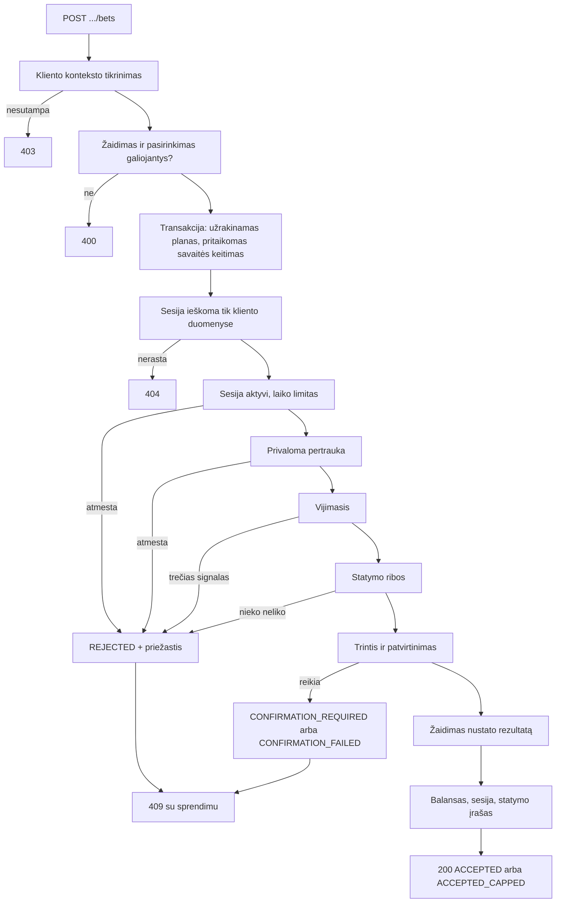
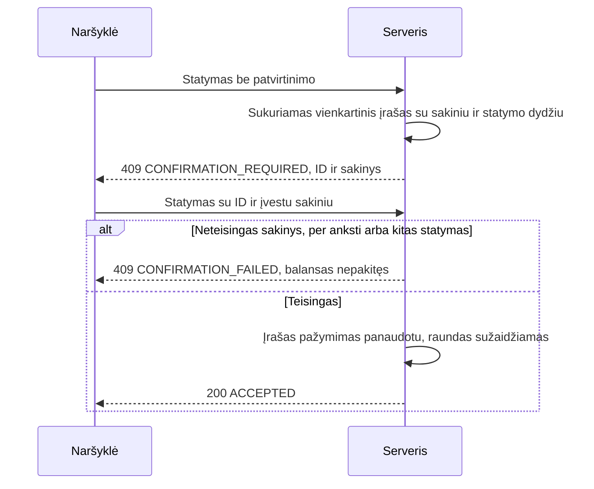
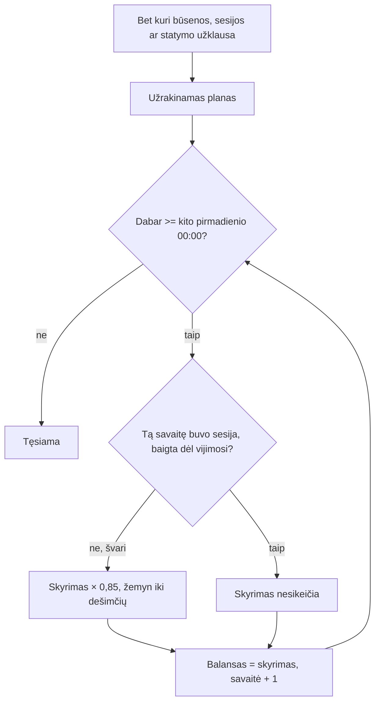
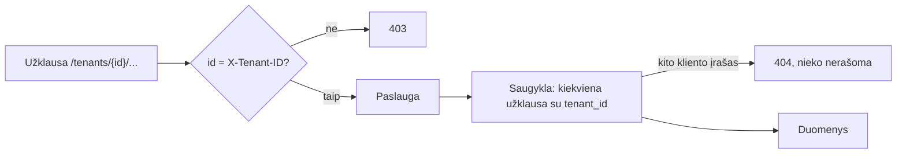

# Veikimo eigos

## Statymo sprendimas

## Patvirtinimas

Sprendimo poveikis (vijimosi signalas, pertrauka) atmetamas, kai statymas sustoja ties patvirtinimu, todėl pakartotas statymas signalo neskaičiuoja dukart.

## Savaitės keitimas

## Kliento duomenų atskyrimas

